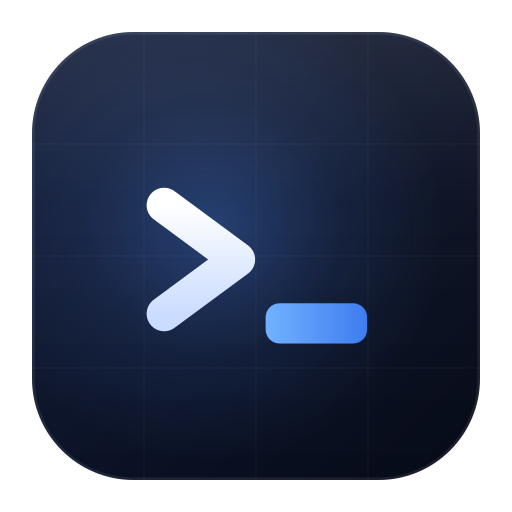
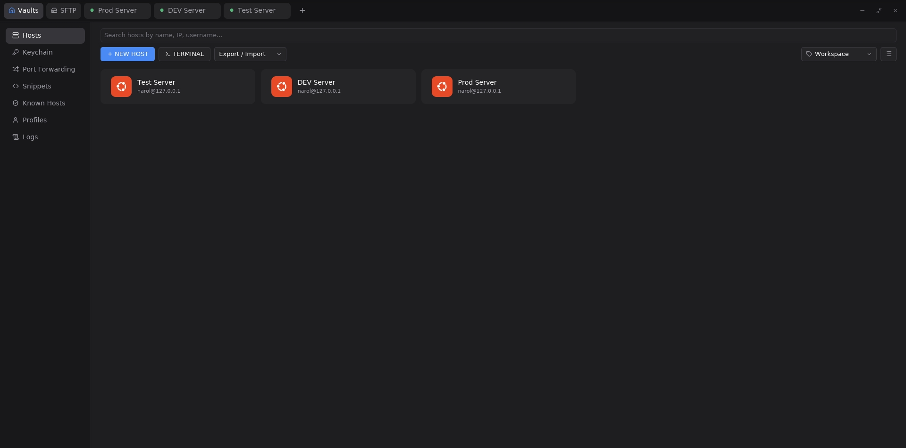

# Termlet



[](https://github.com/narol2026/termlet/actions/workflows/ci.yml)
[](LICENSE)

Termlet is a cross-platform desktop terminal built with [iced](https://github.com/iced-rs/iced).
It focuses on SSH session management: terminals, SFTP, a keychain, port
forwarding, snippets, and known hosts, all in one window.

Linux and macOS are the supported build targets today. Windows builds from
source, but is still being verified and has no official release package yet.

## Screenshot



## Features

### Terminal & SSH

- **SSH terminals** backed by the [russh](https://github.com/warp-tech/russh)
  client. Rendering uses [alacritty_terminal](https://github.com/narol2026/alacritty)
  plus [iced_term](https://github.com/narol2026/iced_term) and vte, all built
  from patched forks pinned to exact commits in [Cargo.toml](Cargo.toml).
- **Local terminals** alongside SSH sessions (`--quick-local`).
- **Shell integration** via OSC 7/633 (patched fork): records command history
  and the current working directory.
- **Command history sidebar**: review, copy, and re-run recent commands.
- **Split panes**: drag, resize, and focus panes; split controls are gated by a
  minimum usable pane size. A disconnected session is masked at the pane header.
- **Tab management**: live drag-to-reorder, rename, duplicate a session into a
  new window, close other/right tabs, and a **tab lock** to prevent accidental
  closes.
- **In-terminal search** with match highlighting and next/previous navigation,
  plus case, whole-word, and regex toggles.
- **Port forwarding** with a runtime log you can view and copy.

### Files & hosts

- **SFTP**: file browsing, a transfer queue with overwrite/merge/duplicate
  handling, read-only preview (text is selectable and copyable), rename, create
  directory, delete, filter/sort, drag-and-drop, multiple tabs, and a sidebar.
- **Hosts (vaults)**: manage hosts with password or key authentication, search
  and filter, one-click connect, single-hop ProxyJump, and export/import
  (encrypted `.termlet` backups; legacy `.age` files remain importable).
- **Known hosts**: manage the SSH known-hosts file from the UI.
- **Keychain**: age-encrypted SSH private keys, passphrases, and identities.
- **Snippets**: reusable command snippets grouped into packages.

### Spotlight

- **Command palette** (press `F1` in a terminal): a centered, Alfred-style
  picker over the app's built-in actions — new tab, open local terminal, close
  tab, and **Open in SFTP**. Type to fuzzy-filter; the top match is highlighted
  and Enter runs it.

### Other

- **Themes**: Dark, Light, HighContrast Dark, HighContrast Light, Dracula, and
  Novel (a warm paper reading theme), plus Auto to follow the system.
- **Localization**: English, Simplified Chinese, and Traditional Chinese
  (rust-i18n).
- **Diagnostics**: performance sampling, a freeze watchdog (with a `SIGUSR1`
  stack snapshot), and crash reports.
- **Keybindings**: built-ins defined in
  [src/app/keybindings.rs](src/app/keybindings.rs) and shown read-only in
  Settings; macOS and other platforms share a unified `Cmd`/`Ctrl` modifier.

## Platform support

| Platform | Status |
| --- | --- |
| Linux (x86_64 / aarch64) | ✅ Supported; CI builds a `.deb` for both architectures against glibc 2.35 |
| macOS Apple Silicon (arm64) | ✅ Supported build target; CI builds a `.dmg` on macOS 15 |
| macOS Intel (x86_64) | ✅ Supported build target; CI builds a `.dmg` on macOS 15 |
| Windows | 🚧 Source builds are available, but Windows is not covered by CI and has no official release package |

The codebase has `target_os = "macos"` branches (window chrome, cursor,
keybindings, theme detection) but no architecture-specific code, so Apple
Silicon builds and runs directly.

There is no tagged release yet. Until `v1.0.0` is published, build from source;
the packages produced by CI are build artifacts, not supported downloads. The
macOS 15 CI runner does not declare or verify a minimum runtime version for
older macOS releases.

## Building

The compiler is pinned in `rust-toolchain.toml`; rustup installs that exact
version automatically on the first `cargo` command, so a local build uses the
same toolchain as CI and the release workflow.

### Windows

Install Visual Studio Build Tools with the **Desktop development with C++**
workload, Rust, and [Inno Setup 6](https://jrsoftware.org/isinfo.php). Then run:

```bat
packaging\windows\build.cmd
```

This produces a portable ZIP and a per-user installer in `dist/`. The installer
does not require administrator access, and uninstalling it preserves the
contents of `%USERPROFILE%\.termlet\`. The build statically links the Microsoft
C runtime, so the installed program does not require the Visual C++
Redistributable. SSH sessions use the bundled `termlet-bridge.exe`; no external
OpenSSH client is required.

### Linux

```bash
# Requires cargo-deb; builds target/debian/termlet_<version>_<arch>.deb
packaging/debian/build.sh
```

See [`packaging/debian/README.md`](packaging/debian/README.md) for package
details.

The `keyring` crate links `libdbus` through its `sync-secret-service` backend,
so building on Linux requires `libdbus-1-dev` (the runtime only needs the
`libdbus-1` shared library).

### macOS

Install the Rust toolchain, then:

```bash
cargo build --release                  # current Mac architecture

# Target a specific architecture:
rustup target add aarch64-apple-darwin   # Apple Silicon (M1/M2/M3/M4)
# Intel: rustup target add x86_64-apple-darwin

cargo build --release --target aarch64-apple-darwin
```

Packaging uses [cargo-bundle](https://github.com/burtonageo/cargo-bundle)
(`[package.metadata.bundle]` is already configured):

```bash
cargo install cargo-bundle

packaging/macos/build.sh                    # produce the .app
packaging/macos/build.sh --format dmg       # produce a current-arch .dmg

# Universal binary covering Apple Silicon and Intel:
rustup target add x86_64-apple-darwin
packaging/macos/build.sh --format dmg --universal
```

Artifacts land under `target/release/bundle/`: the `.app` in `osx/` and the
`.dmg` in `dmg/`.

See [`packaging/macos/README.md`](packaging/macos/README.md) for target and
output options.

> Distributing to others requires signing and notarizing separately with
> `codesign` / `notarytool`, otherwise Gatekeeper will block it.
>
> Note: this repository has no Linux → macOS cross-compilation setup
> (osxcross/SDK), so macOS builds must run on a Mac.

### Application icons

There are three platform-aware icon masters. The generic and macOS masters
share the same artwork and differ in transparent safe area; the Windows master
keeps the smallest shell sizes legible:

| Master | Tile size on canvas | Used for |
| --- | --- | --- |
| `assets/app-icons/generic/termlet.svg` | 87.5% | Linux `.desktop`, runtime window icon (`src/main.rs`) |
| `assets/app-icons/macos/termlet.svg` | 80.47% (Apple HIG: 824×824 within a 1024 canvas, corner radius 185.4) | macOS `.icns` (Dock / Finder / Launchpad) |
| `assets/app-icons/windows/termlet.svg` | 87.5%, without grid/border and with an enlarged glyph | Windows `.ico` entries up to 40 px |

The Linux 256 px fallback is stored as
`assets/app-icons/linux/256x256/termlet.png`, keeping the installed filename
aligned with `Icon=termlet` in the desktop entry.

The Dock renders the icon at full canvas size, so a larger tile looks bigger;
macOS therefore uses Apple's official grid (a 100/1024 transparent safe area on
each side) to match the size of built-in apps. `cargo bundle` picks the first
`.icns` in `[package.metadata.bundle] icon`, which is the macOS-specific set.

After editing a master, regenerate the `.icns` (macOS only; uses the system
`sips` and `iconutil`) and the derived platform PNGs:

```bash
tools/icons/build_app_icons.sh          # regenerate the macOS .icns only
tools/icons/build_app_icons.sh all      # regenerate ICNS and both 256 px PNGs
```

The SVG masters use gradients and clipping references. Render them with
`sips` on macOS or a conforming SVG rasteriser such as CairoSVG; ImageMagick's
built-in SVG renderer can drop the background and gradients:

```bash
cairosvg assets/app-icons/generic/termlet.svg \
  -o assets/app-icons/linux/256x256/termlet.png \
  --output-width 256 --output-height 256
cairosvg assets/app-icons/windows/termlet.svg \
  -o assets/app-icons/windows/termlet.png \
  --output-width 256 --output-height 256
```

The asset layout is documented in [`assets/README.md`](assets/README.md). The
Windows ICO is generated from the generic and Windows PNGs on Windows:

```powershell
.\tools\icons\build_windows_icon.ps1
```

## Running

```bash
termlet                            # launch the GUI
termlet --quick-ssh <host_id>      # connect to a saved host (numeric id)
termlet --quick-local              # open a local terminal
termlet --new-window               # start a new window
termlet-bridge <host_id>           # internal SSH bridge process, launched by Termlet
```

Application data and configuration live under `~/.termlet/`.

The environment variable `TERMLET_SHOW_OSC_WATERMARK` (off by default) shows a
semi-transparent `OSC7 · OSC633` watermark at the bottom of a terminal, but only
once shell-integration markers are detected for that terminal.

## Project layout

```
src/
  main.rs          # entry point, CLI flags, iced application setup
  app/             # App state, keybindings, top-level command handling
  core/            # data model, storage, crypto, theme, i18n, diagnostics, paths
  ssh/             # russh client, connection pool, SFTP transfer, shell integration
  ssh_connect/     # connection flow and single-hop ProxyJump
  terminal/        # terminal sessions, search, history, split layout
  sftp/            # SFTP session, browse/transfer/conflict flows, views
  hosts/           # host vault, forms, export/import
  keychain/        # age-encrypted keys, passphrases, identities
  snippets/        # snippets and packages
  port_forward/    # local/remote/dynamic port forwarding and manager
  known_hosts/     # known-hosts management
  workspace/       # workspace snapshots, save/restore, session recovery
  views/           # screen-level views (sidebar, topbar, settings, logs, ...)
  ui/              # reusable widgets (dialogs, overlays, notifications, ...)
  update/          # top-level iced update function
assets/
  app-icons/       # application icon masters, ICO/ICNS bundles, runtime PNG
  desktop/         # Linux desktop entry
  icon-font/       # SVG inputs for the generated UI icon font
  screenshots/     # README image and GitHub social preview
fonts/             # bundled terminal and icon fonts
locales/           # rust-i18n translations
packaging/         # Debian, macOS, and Windows packaging entry points
tools/
  icons/           # icon bundle, .ico, and icon-font generators
  licenses/        # Debian copyright and third-party license generators
```

## Tech stack

- iced 0.14 (canvas / tokio / image / svg), built against a patched fork pinned
  to an exact commit
- tokio, russh / russh-sftp, rusqlite (bundled)
- age (encryption), rust-i18n, lucide-icons
- Patched forks: the `iced` family, `alacritty_terminal`, `vte`, `iced_term`,
  and `iced_drop` are built from forks pinned to exact commits in
  [Cargo.toml](Cargo.toml) (the `[patch.crates-io]` table, plus the
  `iced_drop` dependency). What each fork changes is in
  [PATCHES.md](PATCHES.md).

## Contributing

Contributions are welcome. [CONTRIBUTING.md](CONTRIBUTING.md) covers the
development setup, the checks a change is expected to pass (`cargo fmt`,
`cargo clippy`, `cargo test`), and the commit and code conventions. For
anything larger than a small fix, please open an issue first so we can agree on
the approach before you invest time in a patch.

Please do not report security problems as public issues — report them privately
as described in [SECURITY.md](SECURITY.md). Everyone taking part in the project
is expected to follow the [Code of Conduct](CODE_OF_CONDUCT.md).

## License

Apache-2.0 — see [LICENSE](LICENSE).

Third-party attributions and the full text of every bundled dependency's
license are in [THIRD_PARTY_LICENSES.md](THIRD_PARTY_LICENSES.md); the
Apache-2.0 attribution notice is in [NOTICE](NOTICE). Regenerate the
third-party list after dependency changes with
`python3 tools/licenses/gen_third_party_licenses.py`.
